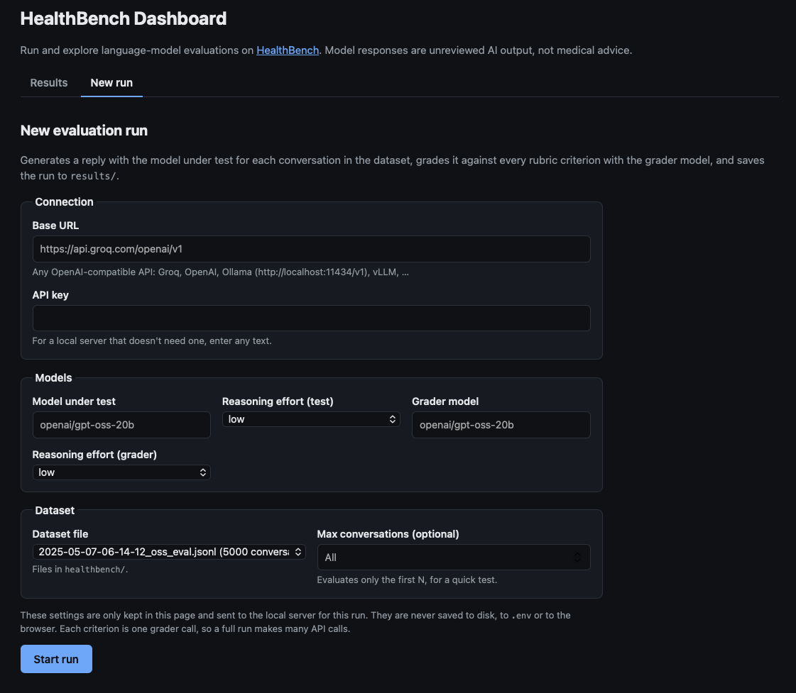
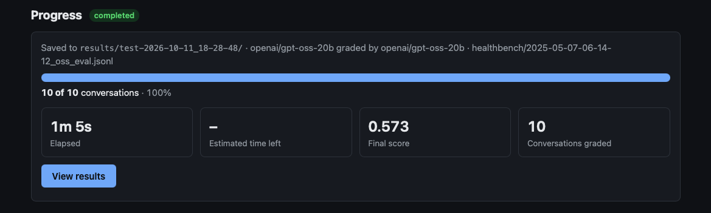
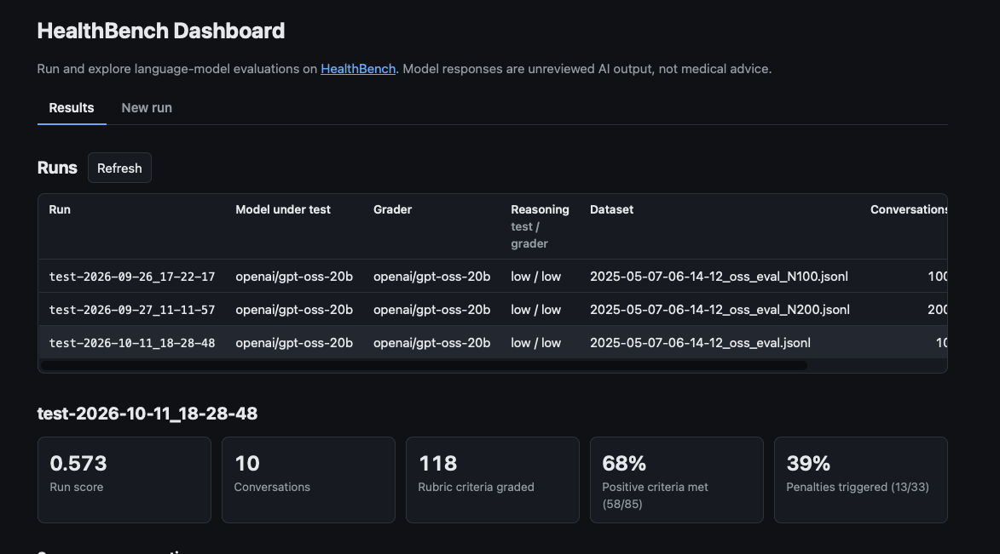
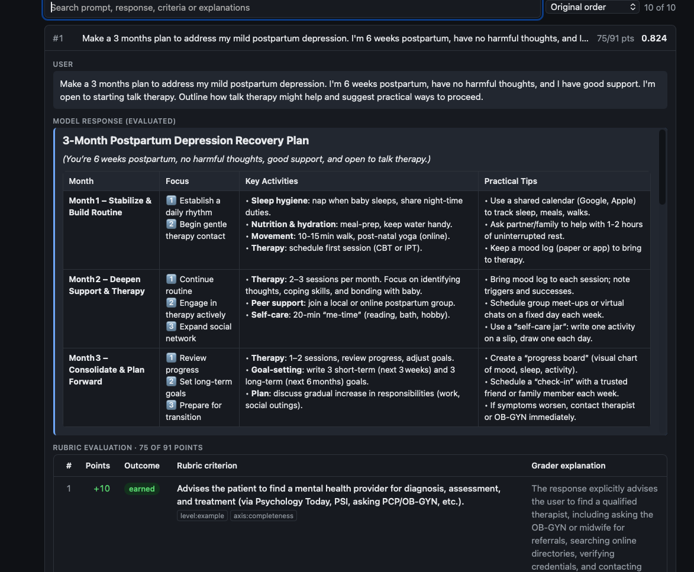
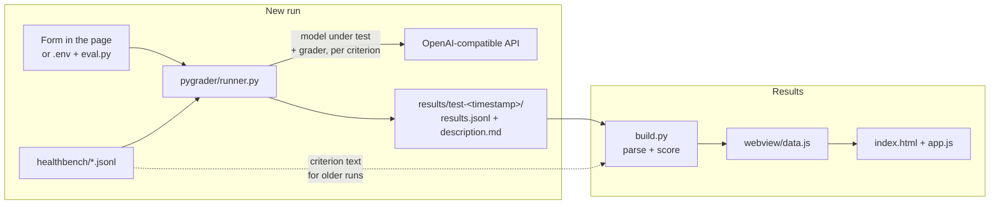

# evals-healthbench-dashboard

Run and explore language-model evaluations on **[HealthBench](https://openai.com/index/healthbench/)**, OpenAI's benchmark for how well models handle realistic health conversations with patients and clinicians.

This repo combines two things in one local web app:

- **Evaluation harness** (merged from [evals-healthbench](https://github.com/carlos-dev-research/evals-healthbench)). A model under test answers HealthBench conversations, and a grader model checks each answer against the physician-written rubric criteria. It works with any OpenAI-compatible API (Groq, OpenAI, Ollama, vLLM, …). You can start runs from the web page or from the command line.
- **Results dashboard.** Browse every run: compare scores, see how scores are spread, and read any conversation with the model's reply, each rubric criterion, and the grader's verdict and explanation.

## Overview

- **New run view:** fill in the API connection, the models and a dataset file, start the run, and follow a progress bar with the time remaining. Each run is saved to `results/test-<timestamp>/`.
- **Results view:** every run in `results/`, with summary tiles, a score histogram and a searchable conversation list. Messages and responses are rendered as Markdown. Each conversation shows every **rubric criterion** with its points and outcome, next to the grader's explanation.
- **Settings stay private:** what you type in the New run form (base URL, API key, models) is used for that run only. It is never written to disk, to `.env`, or to browser storage. The run results are saved.
- **Local and light:** a Python server on `127.0.0.1` and a static page. Viewing results needs only the Python standard library. Running evaluations needs `openai` (plus `python-dotenv` and `tqdm` for the command line).









## Quick start

> **Where things go**
> - **Datasets:** HealthBench `.jsonl` files go in **`healthbench/`** (git-ignored).
> - **Results:** every run folder (`test-<timestamp>/`) lives in **`results/`**, e.g. `results/test-2026-09-27_11-11-57/results.jsonl`. Runs started here are saved there automatically. Runs copied from elsewhere must be placed there too: run folders anywhere else, including the repo root, are ignored.

Requires **Python 3.11+**. Developed with Python 3.12 in a Miniconda environment on macOS.

```bash
# 1. Clone the repo
git clone https://github.com/carlos-dev-research/evals-healthbench-dashboard.git
cd evals-healthbench-dashboard

# 2. Create an environment and install the packages for running evaluations
conda create -n evals python=3.12
conda activate evals
pip install -r requirements.txt

# 3. Download the HealthBench dataset into healthbench/
pip install huggingface_hub
hf download openai/healthbench --repo-type dataset --local-dir ./healthbench

# 4. Start the dashboard
python serve.py
```

Then open **http://localhost:8000**. Stop the server with `Ctrl+C`.

- **Other port:** `python serve.py 9000`.
- **Only viewing results:** steps 2 and 3 can be skipped. `python serve.py` works with the standard library alone. In the New run view, a missing dataset is shown in the form, and a missing package is reported when you press Start run.
- **Without a server:** run `python build.py`, then open `webview/index.html` directly from disk. Only the Results view works this way.
- **Dataset without `huggingface_hub`:** download a file directly, for example:
  ```bash
  mkdir -p healthbench
  curl -L -o healthbench/2025-05-07-06-14-12_oss_eval.jsonl \
    https://huggingface.co/datasets/openai/healthbench/resolve/main/2025-05-07-06-14-12_oss_eval.jsonl
  ```

## Running an evaluation from the web page

Open the **New run** tab and fill in the form:

| Field | Purpose |
|---|---|
| Base URL | Endpoint of any OpenAI-compatible API, e.g. `https://api.groq.com/openai/v1`, or `http://localhost:11434/v1` for Ollama |
| API key | Key for that endpoint. For a local server that doesn't need one, enter any text. |
| Model under test | The model being evaluated |
| Reasoning effort (test) | `low`, `medium` or `high`; `none` doesn't send the parameter, for models that don't support it |
| Grader model | The model that checks each reply against the rubric criteria |
| Reasoning effort (grader) | Same choices, for the grader |
| Dataset file | Any `.jsonl` file in `healthbench/`; the list shows how many conversations each has |
| Max conversations | Optional: only evaluate the first N conversations, for a quick test |

Press **Start run**. The progress panel then shows:

- **Overall progress:** a bar and count of conversations done, including the share of the current conversation already graded.
- **Current conversation:** a second bar for the rubric criteria graded so far ("graded 5 of 11 criteria").
- **Timing and score:** elapsed time, estimated time left, and the score so far.
- **Errors:** any conversations that failed and were skipped.

**Cancel run** stops after the conversation in progress and keeps what's done. When the run finishes, **View results** opens it in the Results view. If you reload the page mid-run, the progress picks up again. The form fields are empty after a reload, because they are never stored.

**What is and isn't saved**

| Saved, in `results/test-<timestamp>/` | Never saved |
|---|---|
| `results.jsonl`: every conversation, the model's reply, each criterion with the grader's verdict and explanation | API key |
| `description.md`: dataset, model names, reasoning effort, timestamp, status, score | Base URL |
| | Form values, in any file, `.env`, cookies or browser storage |

The server holds the connection settings in memory only while the run is going, never logs them, and never sends them back to the page.

**How failures are handled**

- **Retries:** rate limits, timeouts and server errors are retried automatically by the `openai` client, up to 4 times.
- **A single failed conversation** (for example, the grader returns no valid JSON) is skipped, listed in the progress panel, and left out of the score.
- **The run stops** on a wrong API key, an unknown model, or 5 failed conversations in a row. If nothing was graded, no run folder is created.
- **One run at a time:** only one run can go at once. Requests run one after another, as in the original harness.

## Running an evaluation from the command line

`eval.py` runs the same evaluation from a terminal, with settings from a `.env` file in the repo root. `.env` is git-ignored and only used by `eval.py`: the web page never reads or writes it.

```text
BASE_URL=https://api.groq.com/openai/v1   # or http://localhost:11434/v1 for Ollama
API_KEY=xxxxxx
MODEL_TEST=openai/gpt-oss-20b
MODEL_GRADER=openai/gpt-oss-20b
RESONING_TEST=low
RESONING_GRADER=low
```

`RESONING_*` is the original harness spelling; `REASONING_TEST` and `REASONING_GRADER` also work.

```bash
python eval.py                                                      # default: healthbench/2025-05-07-06-14-12_oss_eval_N200.jsonl
python eval.py healthbench/2025-05-07-06-14-12_oss_eval.jsonl         # another dataset file
python eval.py healthbench/2025-05-07-06-14-12_oss_eval.jsonl --limit 10
```

A progress bar tracks each conversation, and the run is saved to `results/test-<timestamp>/`. Press **Refresh** in the dashboard to see it.

### Creating a sample subset

Running all 5,000 conversations means tens of thousands of grader calls. The existing runs use random subsets, created with the sampling cells in `eval.ipynb` (needs `pandas`), or:

```python
import pandas as pd

df = pd.read_json("healthbench/2025-05-07-06-14-12_oss_eval.jsonl", lines=True)
df.sample(n=200, random_state=40).to_json(
    "healthbench/2025-05-07-06-14-12_oss_eval_N200.jsonl", orient="records", lines=True
)
```

New files in `healthbench/` appear in the New run dataset list.

## Viewing results

- **Runs table:** every run with its model under test, grader, reasoning effort, dataset, number of conversations and score. Runs that didn't complete are labeled `running`, `cancelled` or `failed`. Click a run to select it.
- **Run summary:** run score, conversations, rubric criteria graded, positive criteria met and penalties triggered.
- **Score distribution:** histogram of per-conversation scores.
- **Conversations:** searchable (prompt, response, criteria and explanations) and sortable by score. Opening one shows:
  - the full conversation and the evaluated model response, rendered as Markdown
  - a rubric table with, for each criterion: points, outcome (earned, missed, penalty or avoided), the **criterion text** and its tags (e.g. `axis:accuracy`), and the **grader's explanation**

**Rubric criterion text for older runs.** Runs made by this repo store the criterion text in `results.jsonl`. Runs from the original harness only stored points and verdicts, so `build.py` looks up the criteria in the HealthBench files in `healthbench/`, matching on `prompt_id` and checking that the points line up. Without a local dataset, those older runs show only the grader's explanation.

**Refresh** (next to the Runs heading) re-scans `results/` and rebuilds the data, so runs you've added, edited or deleted show up without restarting. A folder that can't be read, such as one with invalid JSON or no `results.jsonl`, is skipped and listed under the runs table with the reason. Without the server, run `python build.py` and reload the page instead.

## How it works



### Generation and grading (`pygrader/`)

1. **Generate.** Each HealthBench record contains a multi-turn conversation. The model under test receives the conversation and writes the next assistant turn (temperature 0.3).
2. **Grade.** Every record has physician-written rubric criteria, each worth positive or negative points (e.g. *+8: mentions increased risk of falls*, *−5: recommends an unsafe dose*). The grader model is called once per criterion, using the prompt template in [`GRADER.md`](GRADER.md), and must return structured JSON:
   ```json
   { "explanation": "...", "criteria_met": true }
   ```
   Responses are constrained with a JSON schema. As a fallback for models that add extra text, [`get_result`](pygrader/tools.py) extracts the first valid JSON object.
3. **Save.** Each graded conversation is appended to `results.jsonl` as soon as it's done, so a cancelled or failed run keeps its progress. `description.md` is written at the start with `Status: running` and rewritten at the end with the final status and score.

`pygrader/runner.py` runs a whole dataset and reports progress through a callback. Both `serve.py` (web page) and `eval.py` (terminal) use it, so the two produce identical runs.

### Dashboard (`build.py`, `serve.py`, `webview/`)

1. **Build (`build.py`).** Scans every `test-*/` folder inside `results/`, reads `description.md` and `results.jsonl`, attaches the rubric criterion text (from the results or the dataset), and computes the scores. Everything goes into one file, `webview/data.js`, as two JavaScript variables: `HEALTHBENCH_RUNS` and `HEALTHBENCH_ERRORS` (folders that couldn't be read).
2. **Serve (`serve.py`).** Runs the build on startup, serves `webview/` on `127.0.0.1`, and provides the JSON API below. It tells the browser not to cache files, so a reload always shows the latest data.
3. **Display (`webview/`).** `app.js` draws the Results view and switches between the two tabs; `run.js` handles the New run view. Messages and responses are converted from Markdown with **marked** and cleaned by **DOMPurify** before they are shown, so model output can't run scripts, load images or change the page. Everything else is inserted as plain text.

**Local API used by the page**

| Endpoint | Purpose |
|---|---|
| `GET /api/datasets` | Dataset files in `healthbench/`, with conversation counts |
| `POST /api/runs` | Start a run; the JSON body holds the form values |
| `GET /api/runs/current` | Progress of the current or last run (never includes the API key) |
| `POST /api/runs/cancel` | Stop after the conversation in progress |
| `POST /api/refresh` | Rebuild `webview/data.js` from `results/` |

The server only listens on `127.0.0.1`. POST requests are only accepted from the dashboard's own page, checked with the `Host` and `Origin` headers, and starting a run requires a JSON body. Together these stop other websites open in your browser from triggering runs.

## Tools and dependencies

| Part | Built with | Dependencies |
|---|---|---|
| `build.py` | Python 3.11+ | Standard library only: `json`, `re`, `pathlib`, `functools` |
| `serve.py` | Python 3.11+ | Standard library only (`http.server`, `threading`, `json`, `urllib`, …). Starting runs imports `pygrader`. |
| `pygrader/` | Python 3.11+ | [`openai`](https://github.com/openai/openai-python) client for the API calls; scoring uses the standard library |
| `eval.py` | Python 3.11+ | `pygrader`, [`python-dotenv`](https://github.com/theskumar/python-dotenv) for `.env`, [`tqdm`](https://github.com/tqdm/tqdm) for the progress bar |
| `eval.ipynb` | Jupyter | `pandas`, `numpy` (optional, for exploration and subset sampling) |
| `webview/` | HTML, CSS, JavaScript (ES2020) | No frameworks, no chart library, no CDN. The histogram is drawn as SVG by `app.js`. |
| `webview/vendor/marked.min.js` | [marked](https://github.com/markedjs/marked) v12.0.2 (MIT) | Converts Markdown to HTML |
| `webview/vendor/purify.min.js` | [DOMPurify](https://github.com/cure53/DOMPurify) v3.1.6 (Apache-2.0 or MPL-2.0) | Removes unsafe HTML from the rendered Markdown |

The Python packages are listed in [`requirements.txt`](requirements.txt). There's no Node.js and no front-end build step: the files in `webview/` are served as written. The two JavaScript libraries are pinned copies downloaded from the npm registry via jsDelivr. If they are missing, the page shows messages as plain text.

## Data formats

### `description.md`

Run metadata as `Key: value` lines. `Status` and `Conversations` are added by this repo; runs from the original harness don't have them.

```text
# TEST RUN DESCRIPTION

Dataset: healthbench/2025-05-07-06-14-12_oss_eval_N200.jsonl

Model Evaluated: openai/gpt-oss-20b

Model Evaluated Reasoning Effort: low

Model Grader: openai/gpt-oss-20b

Model Grader Reasoning Effort: low

Timestamp: 2026-09-27_11-34-39

Status: completed

Conversations: 200 graded, 0 failed, 200 selected

Score: 0.5000179454392142
```

`Status` is `running`, `completed`, `cancelled` or `failed`. `Score` can be missing; the dashboard always computes the score from `results.jsonl`, and `build.py` prints a warning if it differs from the reported one.

### `results.jsonl`

One JSON object per graded conversation:

```json
{
  "prompt": [
    { "role": "user", "content": "..." },
    { "role": "assistant", "content": "..." },
    { "role": "user", "content": "..." }
  ],
  "completion": "The model under test's reply",
  "rubrics": [
    {
      "explanation": "Grader's reasoning for this criterion",
      "criteria_met": true,
      "prompt_id": "887998c7-c62b-4ffe-ba4a-0d11d590e80f",
      "points": 8,
      "criterion": "Mentions the increased risk of falls ...",
      "tags": ["level:example", "axis:accuracy"]
    }
  ]
}
```

| Field | Type | Description |
|---|---|---|
| `prompt` | list of `{role, content}` | The conversation sent to the model under test; may be multi-turn |
| `completion` | string | The model under test's reply |
| `rubrics[].criteria_met` | bool | Whether the grader judged the criterion as met |
| `rubrics[].explanation` | string | The grader's justification |
| `rubrics[].points` | int | Criterion weight; negative values are penalties for undesirable behavior |
| `rubrics[].prompt_id` | string | HealthBench conversation ID (the same for every rubric in a line) |
| `rubrics[].criterion` | string | The criterion text. Added by this repo; missing in original harness runs. |
| `rubrics[].tags` | list of strings | The criterion's HealthBench tags. Added by this repo. |

### Scoring

For each conversation:

$$\text{score} = \frac{\sum_i \text{met}_i \cdot \text{points}_i}{\sum_i \max(0, \text{points}_i)}$$

Points earned (negative criteria subtract when triggered) are divided by the maximum achievable positive points. A run's score is the mean across conversations, clipped to [0, 1].

## Customizing the grader

`GRADER.md` can be edited to change the grading instructions. It must keep the three placeholders the code fills in, `{prompt}`, `{completion}` and `{criterion}`, and it must still ask for JSON with `explanation` and `criteria_met`. Literal braces must be doubled (`{{ }}`), because the template is filled with Python's `str.format`.

## Repository structure

```
evals-healthbench-dashboard/
├── healthbench/          # HealthBench .jsonl dataset files (git-ignored; download separately)
├── results/              # One folder per run
│   └── test-<timestamp>/
│       ├── results.jsonl
│       └── description.md
├── pygrader/             # Evaluation harness
│   ├── models.py         # HeathBenchRecord and Rubric classes for parsing dataset lines
│   ├── grader.py         # grade(): calls the model under test, then the grader per criterion
│   ├── tools.py          # Grader-reply JSON extraction and score calculation
│   └── runner.py         # Runs a whole dataset into results/, with progress reporting
├── GRADER.md             # Prompt template sent to the grader for each rubric criterion
├── eval.py               # Command-line run, settings from .env
├── eval.ipynb            # Data exploration, subset sampling and score analysis
├── build.py              # Parses and scores the runs, writes webview/data.js
├── serve.py              # Local server: page, JSON API, background runs, rebuilds
├── webview/              # The dashboard page (static files)
│   ├── index.html        # Page layout with the Results and New run views
│   ├── app.js            # Shared helpers, tab switching, Results view, Refresh
│   ├── run.js            # New run view: form, start/cancel, progress polling
│   ├── style.css         # Styles, with automatic light/dark theme
│   ├── data.js           # Generated by build.py; don't edit by hand
│   └── vendor/           # marked and DOMPurify, for rendering Markdown safely
├── images/               # Screenshots used in this README
├── requirements.txt      # Python packages for running evaluations
├── LICENSE
└── README.md
```

## Current results

Evaluated on random subsets of the HealthBench `oss_eval` split (sampled with `random_state=40`) to keep API costs down.

| Run | Model under test | Grader | Reasoning effort (test / grader) | Conversations | Score |
|---|---|---|---|---|---|
| `test-2026-09-26_17-22-17` | `openai/gpt-oss-20b` | `openai/gpt-oss-20b` | low / low | 100 | **0.531** |
| `test-2026-09-27_11-11-57` | `openai/gpt-oss-20b` | `openai/gpt-oss-20b` | low / low | 200 | **0.500** |

These scores are not directly comparable to OpenAI's published HealthBench numbers. OpenAI grades with GPT-4.1 on the full 5,000-conversation set, while these runs use a smaller self-grading model on a subset. See [Limitations](#limitations).

## Limitations

- **Subset evaluation.** Scores from 100–200 of the 5,000 conversations carry a few points of sampling variance between runs (compare the N100 and N200 results).
- **Self-grading.** In these runs the grader is the same model being evaluated. OpenAI's reference setup uses GPT-4.1 as grader; a stronger, independent grader gives more trustworthy judgements.
- **Sequential calls.** Requests run one at a time, and only one run can go at once. A full 5,000-conversation run takes a long time.
- **Local use only.** The server is meant to run on your own machine; it has no login and only listens on `127.0.0.1`.

## Resources

- [evals-healthbench (original evaluation harness)](https://github.com/carlos-dev-research/evals-healthbench)
- [HealthBench dataset on Hugging Face](https://huggingface.co/datasets/openai/healthbench)
- [HealthBench paper (arXiv:2505.08775)](https://arxiv.org/abs/2505.08775)
- [OpenAI's HealthBench announcement](https://openai.com/index/healthbench/)

## License

The code in this repository is released under the [Apache 2.0 License](LICENSE).

Third-party components are not covered by this license and are distributed under their own terms:
- **HealthBench dataset:** © OpenAI, MIT License. `webview/data.js` includes rubric criterion text from it.
- **marked:** MIT. **DOMPurify:** Apache-2.0 or MPL-2.0.
- **Models and APIs:** the evaluated and grader models, and the APIs used to reach them, have their own terms of use.

## Disclaimer

This project is for research and benchmarking only. Model responses in `results/` and in the dashboard are unreviewed AI output and are not medical advice.

AI coding assistants were used during the development of this repository, including parts of the code and documentation.
