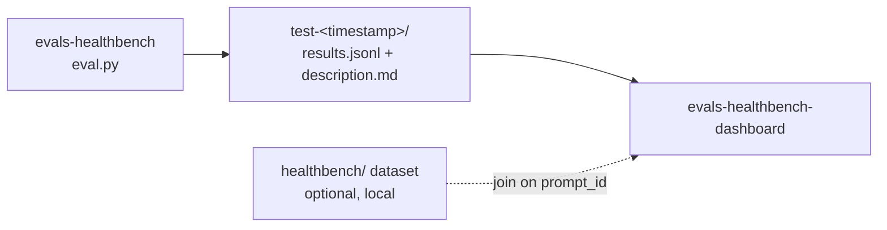

# evals-healthbench-dashboard

A dashboard for exploring the results of language-model evaluations on **[HealthBench](https://openai.com/index/healthbench/)**, OpenAI's benchmark for how well models handle realistic health conversations.

This repo only displays results. They are generated by the companion harness **[evals-healthbench](https://github.com/carlos-dev-research/evals-healthbench)**, which runs a model under test on HealthBench conversations, grades each reply against the physician-written rubrics with a grader model, and writes one `test-<timestamp>/` folder per run. This dashboard reads those folders.



## What the dashboard shows

- **Run overview:** every run with its model under test, grader, reasoning effort, dataset subset, timestamp and final score.
- **Run comparison:** scores side by side across runs (e.g. the N100 vs N200 subsets, or different models).
- **Score distribution:** per-conversation scores within a run, to see where a model does well or badly rather than only the mean.
- **Conversation drill-down:** the conversation sent to the model, the model's reply, and every rubric with its points, whether it was met, and the grader's explanation.
- **Rubric breakdown:** points earned vs. available, with positive criteria met and negative (penalty) criteria triggered.

## Input data

Each run from `evals-healthbench` is a folder named `test-YYYY-MM-DD_HH-MM-SS/` containing two files.

### `description.md`

Run metadata as `Key: value` lines:

```text
# TEST RUN DESCRIPTION

Dataset: healthbench/2025-05-07-06-14-12_oss_eval_N200.jsonl

Model Evaluated: openai/gpt-oss-20b

Model Evaluated Reasoning Effort: low

Model Grader: openai/gpt-oss-20b

Model Grader Reasoning Effort: low

Timestamp: 2026-09-27_11-34-39

Score: 0.5000179454392142
```

`Score` can be missing (e.g. `test-2026-09-26_17-22-17`). When it is, the dashboard recomputes it from `results.jsonl`.

### `results.jsonl`

One JSON object per graded conversation:

```json
{
  "prompt": [
    { "role": "user", "content": "..." },
    { "role": "assistant", "content": "..." },
    { "role": "user", "content": "..." }
  ],
  "completion": "The model under test's reply",
  "rubrics": [
    {
      "explanation": "Grader's reasoning for this criterion",
      "criteria_met": true,
      "prompt_id": "887998c7-c62b-4ffe-ba4a-0d11d590e80f",
      "points": 8
    }
  ]
}
```

| Field | Type | Description |
|---|---|---|
| `prompt` | list of `{role, content}` | The conversation sent to the model under test; may be multi-turn |
| `completion` | string | The model under test's reply |
| `rubrics[].criteria_met` | bool | Whether the grader judged the criterion as met |
| `rubrics[].explanation` | string | The grader's justification |
| `rubrics[].points` | int | Criterion weight; negative values are penalties for undesirable behavior |
| `rubrics[].prompt_id` | string | HealthBench conversation ID (the same for every rubric in a line) |

`results.jsonl` does **not** include the rubric criterion text or HealthBench's theme/axis tags. To show them, the dashboard can join on `prompt_id` with the original dataset. Rubrics are stored in the same order as in the dataset record, so they line up by index.

### Scoring

The dashboard uses the same formula as the harness. For each conversation:

$$\text{score} = \frac{\sum_i \text{met}_i \cdot \text{points}_i}{\sum_i \max(0, \text{points}_i)}$$

Negative criteria subtract points when triggered. A run's score is the mean across conversations, clipped to [0, 1].

## Repository structure

```
evals-healthbench-dashboard/
├── test-<timestamp>/   # Run folders copied from evals-healthbench
│   ├── results.jsonl
│   └── description.md
├── healthbench/        # Optional: original dataset for criterion text and tags (git-ignored)
└── README.md
```

## Getting started

### 1. Get the results

Copy one or more `test-*` folders from [evals-healthbench](https://github.com/carlos-dev-research/evals-healthbench) into this repo's root:

```bash
git clone https://github.com/carlos-dev-research/evals-healthbench ../evals-healthbench
cp -r ../evals-healthbench/test-* .
```

### 2. (Optional) Download the dataset

To show the criterion text and theme/axis tags:

```bash
hf download openai/healthbench --repo-type dataset --local-dir ./healthbench
```

The `healthbench/` folder is git-ignored and is not redistributed by this repo.

### 3. Run the dashboard

_Setup and run instructions will be added with the dashboard code._

## Current results

| Run | Model under test | Grader | Reasoning effort (test / grader) | Conversations | Score |
|---|---|---|---|---|---|
| `test-2026-09-26_17-22-17` | `openai/gpt-oss-20b` | `openai/gpt-oss-20b` | low / low | 100 | **0.531** |
| `test-2026-09-27_11-11-57` | `openai/gpt-oss-20b` | `openai/gpt-oss-20b` | low / low | 200 | **0.500** |

These come from random subsets of the HealthBench `oss_eval` split, graded by the same model under test. They are not directly comparable to OpenAI's published HealthBench numbers, which use GPT-4.1 as grader on the full 5,000-conversation set. See the [harness limitations](https://github.com/carlos-dev-research/evals-healthbench#limitations).

## Resources

- [evals-healthbench (evaluation harness)](https://github.com/carlos-dev-research/evals-healthbench)
- [HealthBench dataset on Hugging Face](https://huggingface.co/datasets/openai/healthbench)
- [HealthBench paper (arXiv:2505.08775)](https://arxiv.org/abs/2505.08775)
- [OpenAI's HealthBench announcement](https://openai.com/index/healthbench/)

## License

The code in this repository is released under the [Apache 2.0 License](LICENSE).

The HealthBench dataset, the evaluated and grader models, and any libraries used are each distributed under their own licenses and terms of use.

## Disclaimer

This project is for research and benchmarking only. Model responses shown in the dashboard are unreviewed AI output and are not medical advice.
