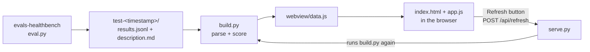

# evals-healthbench-dashboard

A dashboard for exploring the results of language-model evaluations on **[HealthBench](https://openai.com/index/healthbench/)**, OpenAI's benchmark for how well models handle realistic health conversations.

This repo only displays results. They are generated by the companion harness **[evals-healthbench](https://github.com/carlos-dev-research/evals-healthbench)**, which runs a model under test on HealthBench conversations, grades each reply against the physician-written rubrics with a grader model, and writes one `test-<timestamp>/` folder per run. This dashboard reads those folders.

## Overview

- **Purpose:** browse evaluation runs in a web page instead of reading raw JSONL. You can compare run scores, see how scores are spread across conversations, and read any conversation with the model's reply and the grader's verdict on every rubric criterion.
- **Input:** the `test-*/` folders produced by evals-healthbench, copied into this repo. Nothing else is needed: the original HealthBench dataset and API keys are not used.
- **Output:** a static web page in `webview/`, served on your own machine at `http://localhost:8000`.
- **No dependencies:** two small Python scripts using only the standard library, and a page written in plain HTML, CSS and JavaScript. There is nothing to `pip install` or `npm install`, and the page loads nothing from the internet.

## How to run

Requires **Python 3.11+**. Only the standard library is used, so there is nothing to `pip install`. Developed with Python 3.12 in a Miniconda environment.

```bash
# 1. Clone the repo
git clone https://github.com/carlos-dev-research/evals-healthbench-dashboard-.git
cd evals-healthbench-dashboard-

# 2. (Optional) Create an environment
conda create -n evals python=3.12
conda activate evals

# 3. Build the data and serve the dashboard
python serve.py
```

Then open **http://localhost:8000**. Stop the server with `Ctrl+C`.

`serve.py` parses every `test-*/` folder into `webview/data.js` on startup, so no separate build step is needed.

- **Other port:** `python serve.py 9000`.
- **Without a server:** run `python build.py` to generate `webview/data.js`, then open `webview/index.html` directly from disk. The Refresh button needs `serve.py`.

## Adding a new run

1. Copy the run folder from [evals-healthbench](https://github.com/carlos-dev-research/evals-healthbench) into this repo's root. The folder name must start with `test-` and contain a `results.jsonl`:
   ```bash
   cp -r ../evals-healthbench/test-2026-10-01_10-00-00 .
   ```
2. Press **Refresh** next to the Runs heading. The server re-scans the `test-*` folders, rebuilds `webview/data.js` and reloads the page, with no restart needed.

Refresh always rebuilds from what is on disk: edited files are re-read, and deleted folders disappear. A folder that can't be read, such as one with invalid JSON or no `results.jsonl`, is skipped and listed under the runs table with the reason, while the other runs still load. Without the server, run `python build.py` and reload the page instead.

## What the dashboard shows

- **Runs table:** every run with its model under test, grader, reasoning effort, dataset subset, number of conversations and score. Click a run to select it, or press Refresh to pick up newly added runs.
- **Run summary:** run score, conversations, rubric criteria graded, positive criteria met and penalties triggered.
- **Score distribution:** histogram of per-conversation scores, to see where a model does well or badly rather than only the mean.
- **Conversations:** searchable and sortable by score. Opening one shows the full conversation, the evaluated model response, and every rubric with its points, outcome (earned, missed, penalty or avoided) and the grader's explanation.

## How it works



1. **Build (`build.py`).** Scans every `test-*/` folder in the repo root. For each run it reads the metadata from `description.md`, reads every conversation from `results.jsonl`, and computes the per-conversation and per-run scores with the same formula as the harness. Everything goes into one file, `webview/data.js`, as two JavaScript variables: `HEALTHBENCH_RUNS` (the parsed runs) and `HEALTHBENCH_ERRORS` (folders that couldn't be read, with the reason).
2. **Serve (`serve.py`).** Runs the build on startup, then serves the `webview/` folder at `http://localhost:8000`. It only listens on `127.0.0.1`, so other machines can't reach it, and it tells the browser not to cache files so a reload always shows the latest data.
3. **Display (`webview/`).** `index.html` loads `data.js` and then `app.js`, which draws the runs table, the summary tiles, the histogram and the conversation list. Text from the results is inserted as plain text, never as HTML, so model output can't change the page.
4. **Refresh.** The Refresh button sends `POST /api/refresh` to `serve.py`, which re-runs the build and replies with a JSON summary (`{"ok": true, "runs": [...], "errors": [...]}`). The page then reloads with the new `data.js`.

The data is loaded with a `<script>` tag instead of being fetched, which is why `index.html` also works when opened directly from disk.

## Tools and dependencies

| Part | Built with | Dependencies |
|---|---|---|
| `build.py` | Python 3.11+ | Standard library only: `json`, `re`, `pathlib`, `functools` |
| `serve.py` | Python 3.11+ | Standard library only: `http.server`, `threading`, `json`, `traceback`, `functools`, `sys`, `pathlib`, plus `build.py` |
| `webview/` | HTML, CSS, JavaScript (ES2020) | None: no frameworks, no chart library, no CDN. The histogram is drawn as SVG by `app.js`. |

To run it you need **Python 3.11 or newer** and any current web browser (Chrome, Firefox, Safari or Edge). It was developed with Python 3.12 in a Miniconda environment on macOS. There's no Node.js and no build tooling for the front end: the files in `webview/` are served as written.

## Input data

Each run from `evals-healthbench` is a folder named `test-YYYY-MM-DD_HH-MM-SS/` containing two files.

### `description.md`

Run metadata as `Key: value` lines:

```text
# TEST RUN DESCRIPTION

Dataset: healthbench/2025-05-07-06-14-12_oss_eval_N200.jsonl

Model Evaluated: openai/gpt-oss-20b

Model Evaluated Reasoning Effort: low

Model Grader: openai/gpt-oss-20b

Model Grader Reasoning Effort: low

Timestamp: 2026-09-27_11-34-39

Score: 0.5000179454392142
```

`Score` can be missing (e.g. `test-2026-09-26_17-22-17`). The dashboard always computes the score from `results.jsonl`, and `build.py` prints a warning if it differs from the reported one.

### `results.jsonl`

One JSON object per graded conversation:

```json
{
  "prompt": [
    { "role": "user", "content": "..." },
    { "role": "assistant", "content": "..." },
    { "role": "user", "content": "..." }
  ],
  "completion": "The model under test's reply",
  "rubrics": [
    {
      "explanation": "Grader's reasoning for this criterion",
      "criteria_met": true,
      "prompt_id": "887998c7-c62b-4ffe-ba4a-0d11d590e80f",
      "points": 8
    }
  ]
}
```

| Field | Type | Description |
|---|---|---|
| `prompt` | list of `{role, content}` | The conversation sent to the model under test; may be multi-turn |
| `completion` | string | The model under test's reply |
| `rubrics[].criteria_met` | bool | Whether the grader judged the criterion as met |
| `rubrics[].explanation` | string | The grader's justification |
| `rubrics[].points` | int | Criterion weight; negative values are penalties for undesirable behavior |
| `rubrics[].prompt_id` | string | HealthBench conversation ID (the same for every rubric in a line) |

### Scoring

The dashboard uses the same formula as the harness. For each conversation:

$$\text{score} = \frac{\sum_i \text{met}_i \cdot \text{points}_i}{\sum_i \max(0, \text{points}_i)}$$

Negative criteria subtract points when triggered. A run's score is the mean across conversations, clipped to [0, 1].

## Repository structure

```
evals-healthbench-dashboard/
├── test-<timestamp>/   # Run folders copied from evals-healthbench
│   ├── results.jsonl
│   └── description.md
├── build.py            # Parses and scores the runs, writes webview/data.js
├── serve.py            # Local server: serves webview/, rebuilds on startup and on Refresh
├── webview/            # The dashboard page (static files)
│   ├── index.html      # Page layout; loads data.js then app.js
│   ├── app.js          # Renders tables, tiles, histogram and conversations; Refresh button
│   ├── style.css       # Styles, with automatic light/dark theme
│   └── data.js         # Generated by build.py; don't edit by hand
├── LICENSE
└── README.md
```

## Current results

| Run | Model under test | Grader | Reasoning effort (test / grader) | Conversations | Score |
|---|---|---|---|---|---|
| `test-2026-09-26_17-22-17` | `openai/gpt-oss-20b` | `openai/gpt-oss-20b` | low / low | 100 | **0.531** |
| `test-2026-09-27_11-11-57` | `openai/gpt-oss-20b` | `openai/gpt-oss-20b` | low / low | 200 | **0.500** |

These come from random subsets of the HealthBench `oss_eval` split, graded by the same model under test. They are not directly comparable to OpenAI's published HealthBench numbers, which use GPT-4.1 as grader on the full 5,000-conversation set. See the [harness limitations](https://github.com/carlos-dev-research/evals-healthbench#limitations).

## Resources

- [evals-healthbench (evaluation harness)](https://github.com/carlos-dev-research/evals-healthbench)
- [HealthBench dataset on Hugging Face](https://huggingface.co/datasets/openai/healthbench)
- [HealthBench paper (arXiv:2505.08775)](https://arxiv.org/abs/2505.08775)
- [OpenAI's HealthBench announcement](https://openai.com/index/healthbench/)

## License

The code in this repository is released under the [Apache 2.0 License](LICENSE).

The HealthBench dataset, the evaluated and grader models, and any libraries used are each distributed under their own licenses and terms of use.

## Disclaimer

This project is for research and benchmarking only. Model responses shown in the dashboard are unreviewed AI output and are not medical advice.

AI coding assistants were used during the development of this repository, including parts of the code and documentation.
